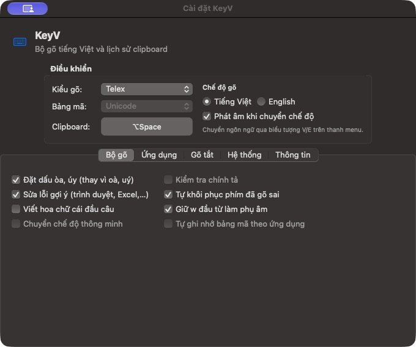
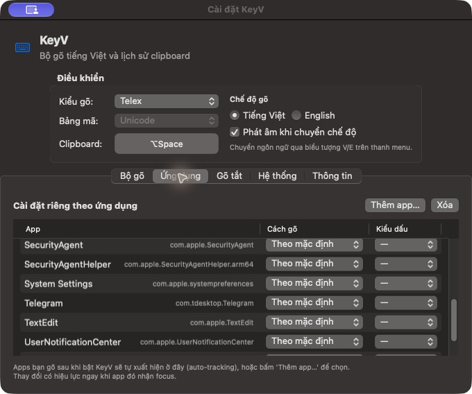
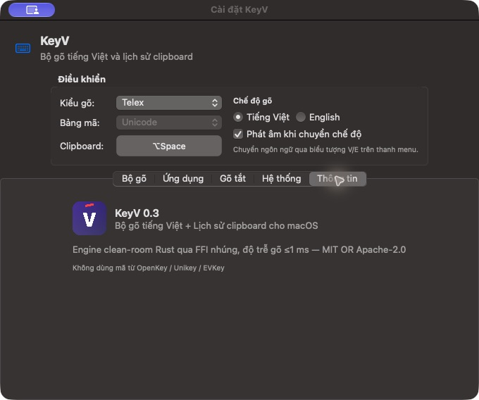

<p align="center"></p>

# KeyV — Bộ gõ tiếng Việt & Lịch sử Clipboard cho macOS

KeyV (`v0.3.4`) là ứng dụng thanh menu (`LSUIElement`) kết hợp **bộ gõ tiếng Việt** và **lịch sử clipboard mã hóa** dành cho macOS 14 trở lên. Nhân xử lý tiếng Việt viết hoàn toàn mới (*clean-room*, không sử dụng mã nguồn GPL bên thứ ba, phát hành theo giấy phép kép MIT / Apache-2.0) bằng Rust không phụ thuộc ngoài, nhúng trực tiếp vào ứng dụng SwiftUI/AppKit qua C ABI (không IPC, không kết nối mạng khi gõ).

## Mục lục

- [Kiến trúc và Tính năng](#kiến-trúc-và-tính-năng)
- [Giao diện Cài đặt và Ảnh tham khảo](#giao-diện-cài-đặt-và-ảnh-tham-khảo)
- [Yêu cầu hệ thống](#yêu-cầu-hệ-thống)
- [Cài đặt và Khởi chạy nhanh](#cài-đặt-và-khởi-chạy-nhanh)
- [Quy tắc gõ tiếng Việt tham khảo](#quy-tắc-gõ-tiếng-việt-tham-khảo)
- [Cấu hình, Dữ liệu cục bộ và Biến môi trường](#cấu-hình-dữ-liệu-cục-bộ-và-biến-môi-trường)
- [Ký số và Phát hành CI/CD](#ký-số-và-phát-hành-cicd)
- [Phát triển, Kiểm thử, Đóng gói và API lõi](#phát-triển-kiểm-thử-đóng-gói-và-api-lõi)
- [Cấu trúc dự án](#cấu-trúc-dự-án)
- [Xử lý sự cố và Giới hạn đã biết](#xử-lý-sự-cố-và-giới-hạn-đã-biết)
- [Giấy phép](#giấy-phép)

## Kiến trúc và Tính năng

KeyV được tổ chức theo mô hình một chiều giữa ba lớp:

1. **Nhân Rust (`crates/keyv-core`)**: Máy trạng thái hữu hạn Telex / Simple Telex / VNI, phân tích âm tiết và ngữ âm học tiếng Việt, bảng gõ tắt (`MacroTable`). Crate không dùng dependency ngoài, biên dịch thành `rlib` và `staticlib` (`libkeyv_core.a`), xuất C ABI tại [`crates/keyv-core/include/keyv.h`](crates/keyv-core/include/keyv.h).
2. **Cầu nối Swift (`CKeyV` + `KeyVCore`)**: `ViEngine` bọc RAII con trỏ `KeyVTyper`, chuyển đổi kết quả từng phím thành `ViEngineAction.pass` (không cấp phát heap ở C ABI) hoặc `.replace(backspaces:chars:)`.
3. **Ứng dụng macOS (`KeyVHostKit` + `KeyVApp`)**: Chạy trên thanh menu (`NSStatusItem`), chặn và phát lại sự kiện bàn phím qua `CGEventTap` (`TapController` + `EventInjector`), kiểm tra tiêu điểm/trường mật khẩu qua Accessibility (`SelectionCacheService`), nhận diện nguồn nhập từ xa (`RemoteInputDetector`), lưu clipboard mã hóa AES-256-GCM trong SQLite (`ClipboardCaptureService` + `ClipboardStore`), và tự động cập nhật từ GitHub Releases (`UpdateService`).

| Nhóm tính năng | Chi tiết xác minh từ mã nguồn |
| --- | --- |
| Kiểu gõ & bảng mã | **Telex** (bỏ dấu tự do, `ươ` một phím `w`, gõ dấu/mũ trễ như `lene` → `lên`, `dand` → `đan`, `muaw` → `mưa`, `duongwfd` → `đường`), **Simple Telex** (không mở rộng `w` độc lập thành `ư` và tắt bỏ dấu mũ/móc/gạch trễ như `dand`, `lene`, `comw`, `dduongwf`), **VNI** (`1–5` thanh điệu, `6` mũ, `7` móc, `8` trăng, `9` gạch `đ`, `0` bỏ dấu) và **English** (`Off`); xuất Unicode dựng sẵn (NFC). |
| Đặt dấu & tái định vị | Hỗ trợ **Kiểu cũ / Truyền thống** (`òa, ọe, úy` — mặc định) và **Kiểu mới** (`oà, oẹ, uý`); tự dời dấu thanh và tự thêm mũ vần đóng (`muonj` → `muộn`, `ddienf` → `điền`) khi gõ tiếp nguyên âm hoặc phụ âm cuối (`toafn` → `toàn`, `gifa` → `già`, `qura` → `quả`, `khuyur` → `khuỷu`). |
| Chính tả, song ngữ & viết tắt | Phân tích âm tiết tiếng Việt để giữ nguyên hoặc tự khôi phục từ tiếng Anh (`terminal`, `macos`, `github`, `Windows`, `data`, `photo`), camelCase (`useState`, `getElementById`), snake_case/mã số (`is_valid`, `0xcafe`), từ rút gọn (`don't`, `isn't`), phím lặp hoàn tác (`aaa`, `ddd`, `aww`, `tesst`, `casse`) và viết tắt chat tiếng Việt (`ddc` → `đc`, `sddt` → `sđt`, `gdd` → `gđ`, `hddqt` → `hđqt`). Khôi phục ranh giới từ trên dấu cách, dấu câu, `Return`, `Keypad Enter` và `Tab`. |
| Gõ nhanh, Backspace & tương thích | Đồng bộ Backspace (`⌫`) trên buffer âm tiết tối đa 32 ký tự (`MAX_WORD_LEN`); tính diff tối thiểu số phím xóa; tuần tự hóa FIFO sự kiện trong cửa sổ 80 ms sau mỗi lần thay thế và nuốt `keyUp` của phím đã tiêu thụ; bỏ qua phím giữ lặp (`autorepeat`) và trường mật khẩu (`IsSecureEventInputEnabled` + `AXSecureTextField`, tự phục hồi khi cờ toàn hệ thống bị kẹt). Tùy chọn *Tương thích gợi ý tự động* chèn đệm `U+202F` khi cần trên trình duyệt (`Chrome`, `Arc`, `Brave`, `Edge`, `Vivaldi`, `Opera`, `Orion`, `Zen`, `Safari`, `Firefox`), `Excel`, `Spotlight`, `Raycast`, `Alfred`, đồng thời tự bỏ qua `AXWebArea` và 8 trình giả lập Terminal (`Terminal`, `iTerm2`, `Ghostty`, `Warp`, `Kitty`, `Alacritty`, `WezTerm`, `Hyper`). |
| Nhập liệu từ xa (Remote Desktop) | Tự nhận diện 8 nhóm máy chủ từ xa (`RustDesk`, `AnyDesk`, `TeamViewer`, `Screen Sharing` / ARD / Screens Connect / RealVNC, `Parsec`, `Jump Desktop`, `Chrome Remote Desktop`, `Sunshine` / Moonlight), hỗ trợ `ENIGO_INPUT_EXTRA_VALUE` (`100`) và lọc chuỗi sentinel `'1'` từ RustDesk iOS. Cung cấp 3 chế độ trong **Cài đặt → Hệ thống** và menu thanh trạng thái: *Tự động thông minh* (mặc định), *Nhường bàn phím điện thoại* và *Luôn dùng KeyV*. |
| Chuyển nhanh Việt / Anh | Chạm-thả **Ctrl + Shift** (bật mặc định), phím tắt toàn cục tùy chỉnh (**Option + Z** / `⌥ Z` mặc định), hoặc nhấn biểu tượng **V / E** trên thanh menu (biểu tượng đổi thành `!` khi thiếu quyền Trợ năng và hiện chấm báo khi có bản cập nhật; tùy chọn âm báo khi chuyển). |
| Cấu hình theo ứng dụng | Tự ghi nhận các ứng dụng bạn sử dụng hoặc thêm thủ công từ `/Applications`; đặt riêng kiểu gõ và kiểu dấu theo `bundleIdentifier` và áp dụng tức thì khi đổi cửa sổ. |
| Gõ tắt (Macro) | Bảng TSV (`<từ_viết_tắt><Tab><nội_dung>`) sửa trực tiếp hoặc thêm nhanh trong **Cài đặt → Gõ tắt**, nạp lại ngay khi lưu (mặc định tắt); khớp chính xác khi kết thúc từ, tự viết HOA toàn bộ khi gõ tắt IN HOA dài ≥ 2 ký tự (`DDK` → `ĐĂNG KÝ`) và viết hoa chữ cái đầu nếu kích hoạt đầu câu. |
| Lịch sử Clipboard mã hóa | Tự động ghi văn bản, hình ảnh (`PNG`/`TIFF`) và đường dẫn tệp (kiểm tra mỗi 0,25 giây, chống trùng lặp liên tiếp, giới hạn 50–1000 mục, mặc định 200); mã hóa **AES-256-GCM** với khóa 256-bit trong macOS Keychain; bỏ qua `org.nspasteboard.ConcealedType`, `TransientType`, `AutoGeneratedType`. Mở nhanh bằng **Option + Space** (`⌥ Space`), tìm theo nội dung / tên tệp / ứng dụng nguồn, dùng `↑`/`↓` và `Enter` (hoặc nhấp đúp) để dán, `Esc` lần 1 xóa bộ lọc và lần 2 đóng cửa sổ. |
| Tự động cập nhật & khởi động | Tự kiểm tra mỗi 12 giờ từ GitHub Releases (`nhuuduc/keyv`, bỏ qua draft/prerelease); xác minh SHA-256 khi bản phát hành cung cấp trường `digest` hoặc tệp `SHA256SUMS.txt`/`*.sha256`, đồng thời luôn kiểm tra Bundle ID `app.keyv.host`, gỡ `com.apple.quarantine` và chạy `codesign --verify --deep --strict`, thay thế `.app` kèm rollback dự phòng và tự mở lại; hỗ trợ mở cùng macOS qua `SMAppService`. |

## Giao diện Cài đặt và Ảnh tham khảo

Ở phiên bản `0.3.4`, cửa sổ **Cài đặt KeyV** (`⌘ ,`) gồm thanh trạng thái trực tiếp (quyền Trợ năng + chế độ gõ), hai khối điều khiển nhanh (*Ngôn ngữ & Phím chuyển* và *Lịch sử Clipboard*) và 5 thẻ:

- **Bộ gõ**: đặt dấu kiểu truyền thống, kiểm tra chính tả tiếng Việt, giữ `W` đầu từ làm phụ âm, khôi phục khi gõ lặp, tự viết hoa đầu câu, tương thích gợi ý tự động, nút khôi phục mặc định chuẩn UniKey.
- **Ứng dụng**: danh sách ứng dụng đã dùng hoặc thêm thủ công với kiểu gõ và kiểu dấu riêng theo từng `bundleIdentifier`.
- **Gõ tắt**: bật/tắt bảng gõ tắt, thêm nhanh quy tắc và trình soạn thảo TSV trực tiếp (`macros.tsv`).
- **Hệ thống**: chế độ *Nhập liệu từ xa (RustDesk / Điện thoại)*, *Cập nhật tự động*, *Khởi động cùng macOS & Quyền Trợ năng*, và giới hạn lưu trữ / xóa toàn bộ lịch sử clipboard.
- **Thông tin**: phiên bản đang chạy, trạng thái chữ ký số & duy trì quyền TCC, liên kết kiểm tra cập nhật và trang GitHub.

<details>
<summary>Ảnh chụp giao diện tham khảo (chụp ở bản v0.3 trước đợt nâng cấp giao diện Cài đặt và v0.3.4)</summary>

- **Bộ gõ**:

  

- **Ứng dụng**:

  

- **Gõ tắt**:

  

- **Hệ thống**:

  

- **Thông tin**:

  

</details>

## Yêu cầu hệ thống

- **Chạy ứng dụng**: macOS 14.0 trở lên (Universal `arm64` + `x86_64`) và cấp quyền **System Settings → Privacy & Security → Accessibility** cho `KeyV`.
- **Build từ mã nguồn**:
  - macOS 14+ với Xcode hoặc Xcode Command Line Tools hỗ trợ **Swift 5.10+** (đã kiểm thử cục bộ trên Swift 6.4).
  - Rust stable hỗ trợ **edition 2024** và **`let` chains** (**Rust 1.88+**; đã kiểm thử cục bộ trên Rust 1.95.0). Để build Universal (`KEYV_UNIVERSAL=1`), cần cả hai target `aarch64-apple-darwin` và `x86_64-apple-darwin` (`scripts/build.sh` tự chạy `rustup target add` nếu có `rustup`).
  - Công cụ hệ thống macOS: `zsh`, `cargo`, `swift`, `codesign`, `security`, `lipo` (khi build Universal), `openssl`, `ditto`, `hdiutil`, `shasum`, `/usr/libexec/PlistBuddy` (và `iconutil` nếu tạo lại icon bằng `scripts/make_icon.swift`).

## Cài đặt và Khởi chạy nhanh

### Cách 1: Cài đặt từ bản phát hành sẵn (GitHub Releases)

1. Tải tệp `.dmg` hoặc `.zip` (ví dụ `KeyV-<version>-macos-universal.dmg`, `KeyV-<version>-macos-universal.zip` hoặc `KeyV-macos.zip`) cùng `SHA256SUMS.txt` tại [GitHub Releases](https://github.com/nhuuduc/keyv/releases).
2. Kiểm tra toàn vẹn SHA-256 trong thư mục chứa tệp đã tải:

```zsh
shasum -a 256 -c SHA256SUMS.txt --ignore-missing
```

3. Kéo `KeyV.app` vào `/Applications` và mở ứng dụng.

### Cách 2: Build từ mã nguồn

```zsh
git clone https://github.com/nhuuduc/keyv.git
cd keyv

# (Khuyến nghị, chạy 1 lần) Tạo chứng chỉ ký cục bộ để giữ quyền Trợ năng qua các lần build lại
./scripts/setup_signing_cert.sh

# Build Rust staticlib + Swift host, chạy KeyVSmoke và đóng gói KeyV.app
./scripts/build.sh
open apps/keyv-app/KeyV.app
```

> Lưu ý: `./scripts/build.sh` biên dịch ở cấu hình release, chạy bộ kiểm thử Swift `KeyVSmoke` và đóng gói `apps/keyv-app/KeyV.app`, nhưng **không** chạy `cargo fmt`, `cargo clippy` hoặc `cargo test --workspace` (xem mục [Phát triển, Kiểm thử, Đóng gói và API lõi](#phát-triển-kiểm-thử-đóng-gói-và-api-lõi)).

### Cấp quyền Trợ năng lần đầu

Khi chưa có quyền Trợ năng (`AXIsProcessTrustedWithOptions`), biểu tượng thanh menu hiển thị `!` và cửa sổ **Thiết lập KeyV** tự mở với nút **Mở Cài đặt Trợ năng…** (`Privacy_Accessibility`). Sau khi bạn bật công tắc cho **KeyV**, ứng dụng tự kiểm tra mỗi 1,5 giây, kích hoạt `CGEventTap` và thu gọn lên thanh menu.

### Phím tắt mặc định

| Thao tác | Phím tắt mặc định | Ghi chú |
| --- | --- | --- |
| Chuyển nhanh Tiếng Việt / English | **Ctrl + Shift** (chạm và thả) | Bật mặc định (`ctrlShiftSwitch`), kiểu UniKey Windows |
| Chuyển Tiếng Việt / English (toàn cục) | **Option + Z** (`⌥ Z`) | Tùy chỉnh trong **Cài đặt → Ngôn ngữ & Phím chuyển** |
| Mở Lịch sử Clipboard | **Option + Space** (`⌥ Space`) | Tùy chỉnh trong **Cài đặt → Lịch sử Clipboard** |
| Mở Cài đặt KeyV | **Command + ,** (`⌘ ,`) | Từ menu thanh trạng thái hoặc menu ứng dụng |
| Thoát KeyV | **Command + Q** (`⌘ Q`) | Từ menu thanh trạng thái hoặc menu ứng dụng |

## Quy tắc gõ tiếng Việt tham khảo

| Chuỗi phím | Kết quả | Chế độ / Ghi chú |
| --- | --- | --- |
| `dduowngf`, `dduongwf`, `duongwfd` | `đường` | Telex bỏ dấu tự do, `uow` / `uo+w` tự thành `ươ` |
| `nuowcs`, `nguowif`, `ruowuj`, `huowu` | `nước`, `người`, `rượu`, `hươu` | Tự động xử lý vần `ươ` và nguyên âm ba |
| `thuowr` / `thuowng`, `huow` / `huowng` | `thuở` / `thương`, `huơ` / `hương` | Phân biệt vần mở `uơ` và vần đóng `ươ` |
| `toafn`, `gifa`, `qura`, `khuyur` | `toàn`, `già`, `quả`, `khuỷu` | Tự động định vị lại dấu thanh khi gõ thêm âm |
| `muonj`, `ddienf`, `lene`, `soso`, `nhapja` | `muộn`, `điền`, `lên`, `số`, `nhập` | Tự thêm mũ vần đóng, mũ trễ và gõ nhanh rollover |
| `muaw`, `choiw`, `comw`, `nhungwx` | `mưa`, `chơi`, `cơm`, `những` | Bỏ dấu `w` cuối âm tiết |
| `duong972`, `dang9`, `to16`, `ha20` | `đường`, `đang`, `tố`, `ha` | VNI (`9` gạch `đ`, `0` bỏ dấu) |
| `ddc `, `sddt `, `gdd `, `hddqt `, `dddc ` | `đc `, `sđt `, `gđ `, `hđqt `, `ddc ` | Viết tắt chat và thoát 3 phím `d` |
| `terminal`, `macos`, `github`, `Windows`, `data `, `useState`, `don't` | Giữ nguyên | Tự giữ/khôi phục khi bật *Kiểm tra chính tả tiếng Việt* |
| `aaa`, `ddd`, `aww`, `dduoww`, `barr`, `tesst`, `casse`, `baszz` | `aa`, `dd`, `aw`, `đuow`, `bar`, `test`, `case`, `baz` | Phím lặp khôi phục ký tự gốc và `z` bỏ dấu |

## Cấu hình, Dữ liệu cục bộ và Biến môi trường

### Tùy chọn mặc định trên ứng dụng macOS (`AppSettings`)

Ứng dụng macOS lưu cấu hình trong `UserDefaults` dưới domain `app.keyv.host` (schema v3):

| Khóa `UserDefaults` | Giá trị mặc định | Ý nghĩa |
| --- | --- | --- |
| `method` | `1` (`Telex`) | Kiểu gõ (`0` Off, `1` Telex, `2` Simple Telex, `3` VNI) |
| `orthography` | `0` (`Traditional`) | Quy tắc đặt dấu (`0` Truyền thống `òa, úy`; `1` Kiểu mới `oà, uý`) |
| `macroEnabled` | `false` | Bật/tắt gõ tắt (`macros.tsv`) |
| `allowWAsConsonant` | `true` | Giữ `w` đầu từ làm phụ âm (tắt để `w` → `ư`) |
| `repeatedRestore` | `true` | Nhấn lặp lại phím dấu/mũ để hoàn tác ký tự gốc |
| `spellCheck` | `true` | Kiểm tra ngữ âm học tiếng Việt & khôi phục từ tiếng Anh (Lưu ý: `Config::default()` trong Rust `keyv-core` đặt `spell_check = false` khi dùng trực tiếp thư viện) |
| `compatFix` | `true` | Chèn `U+202F` chống lỗi autocomplete trên trình duyệt, Excel, Spotlight/Raycast/Alfred |
| `autoCapitalize` | `false` | Tự viết hoa chữ cái đầu câu sau `.`, `!`, `?`, xuống dòng |
| `beepOnModeSwitch` | `true` | Phát âm báo khi đổi Việt / Anh |
| `ctrlShiftSwitch` | `true` | Bật tổ hợp chạm-thả **Ctrl + Shift** đổi Việt / Anh |
| `toggleHotKeyCode` / `toggleHotKeyModifiers` | `6` / `optionKey` | Phím tắt chuyển Việt / Anh (`Option + Z`) |
| `overlayHotKeyCode` / `overlayHotKeyModifiers` | `49` / `optionKey` | Phím tắt mở Lịch sử Clipboard (`Option + Space`) |
| `autoCheckUpdates` | `true` | Tự động kiểm tra bản phát hành mới mỗi 12 giờ |
| `clipboardRetentionLimit` | `200` | Số mục clipboard lưu tối đa (thanh chỉnh 50–1000, bước 50) |
| `remoteDesktopMode` | `0` (`smartAuto`) | Xử lý nhập liệu từ xa (`0` Tự động thông minh, `1` Nhường bàn phím ĐT, `2` Luôn dùng KeyV) |

### Vị trí dữ liệu cục bộ

- **Cơ sở dữ liệu clipboard**: `~/Library/Application Support/KeyV/clipboard.db` (SQLite, payload mã hóa AES-256-GCM; khóa 256-bit lưu trong macOS Keychain với service `KeyV`, account `clipboard-vault-key`).
- **Bảng gõ tắt**: `~/Library/Application Support/KeyV/macros.tsv` (mỗi dòng `<từ_viết_tắt>\t<nội_dung>`; nếu chưa có tệp, ứng dụng nạp mẫu `hvbt\tNhé bạn`).
- **Tùy chọn ứng dụng & cấu hình riêng theo app**: `UserDefaults` (`app.keyv.host`), bao gồm `seenApps` và `appOverrides`.
- **Keychain & chứng chỉ ký cục bộ (tùy chọn)**: `~/.config/keyv/signing-keychain-pass`, `~/.config/keyv/keyv-signing.p12`, `~/Library/Keychains/keyv-signing.keychain-db` — chỉ tạo khi chạy `./scripts/setup_signing_cert.sh`. Không bao giờ commit các tệp này.

### Biến môi trường build và đóng gói

| Tên biến | Mặc định | Script sử dụng | Mô tả |
| --- | --- | --- | --- |
| `KEYV_UNIVERSAL` | `0` | [`scripts/build.sh`](scripts/build.sh), [`scripts/make_app.sh`](scripts/make_app.sh) | Đặt `1` để build Universal (`arm64` + `x86_64`) qua `lipo` và `swift build --arch arm64 --arch x86_64` |
| `KEYV_VERSION` | Đọc từ `CFBundleShortVersionString` (`0.3.4`) | [`scripts/make_app.sh`](scripts/make_app.sh), [`scripts/package_release.sh`](scripts/package_release.sh) | Ghi đè phiên bản (tự bỏ tiền tố `v`) vào `Info.plist` và tên tệp phát hành |
| `KEYV_ARCH_LABEL` | `macos-universal` | [`scripts/package_release.sh`](scripts/package_release.sh) | Hậu tố kiến trúc trong tên tệp `.zip` và `.dmg` |
| `KEYV_BIN_PATH` | Đường dẫn từ `swift build --show-bin-path` | [`scripts/make_app.sh`](scripts/make_app.sh) | Đường dẫn trực tiếp tới binary `KeyVApp` cần đóng gói |
| `KEYV_SIGNING_IDENTITY` | Tự dò theo thứ tự ưu tiên | [`scripts/make_app.sh`](scripts/make_app.sh) | Chỉ định tên hoặc SHA-1 certificate (`-` cho ad-hoc) |
| `KEYV_KEYCHAIN_PATH` | `~/Library/Keychains/keyv-signing.keychain-db` | [`scripts/make_app.sh`](scripts/make_app.sh) | Keychain dùng khi gọi `codesign` |
| `KEYV_CERT_NAME` | `KeyV Code Signing` | [`scripts/setup_signing_cert.sh`](scripts/setup_signing_cert.sh) | Common Name của chứng chỉ tự ký cục bộ |

## Ký số và Phát hành CI/CD

macOS gắn quyền **Privacy & Security → Accessibility (TCC)** với *Designated Requirement* của chữ ký trong `KeyV.app`:

- Khi ký ad-hoc (`codesign --sign -`), macOS neo quyền vào mã băm `cdhash` của từng bản build — mỗi lần build lại hoặc cập nhật sẽ mất quyền Trợ năng.
- Khi ký bằng chứng chỉ cố định (`Developer ID Application` hoặc chứng chỉ tự ký `KeyV Code Signing` do `./scripts/setup_signing_cert.sh` tạo), [`scripts/make_app.sh`](scripts/make_app.sh) tự động dò chứng chỉ (ưu tiên `Developer ID Application` → `KeyV Code Signing` → `Apple Development` → ad-hoc `-`) và ký kèm entitlements (`KeyV.entitlements`), giúp giữ nguyên quyền Trợ năng xuyên suốt các lần build lại và tự cập nhật.

Hai workflow GitHub Actions đi kèm:

- [`.github/workflows/ci.yml`](.github/workflows/ci.yml): Chạy trên mọi `push` / `pull_request` vào `main` trên runner `macos-15` — kiểm tra `cargo fmt`, `cargo clippy`, `cargo test --workspace`, build Universal `./scripts/build.sh`, xác minh `lipo -archs` (`arm64` + `x86_64`), kiểm tra ký số cục bộ và đóng gói `dist/`.
- [`.github/workflows/release.yml`](.github/workflows/release.yml): Kích hoạt khi đẩy tag `v*` (ví dụ `git tag v0.3.4 && git push origin v0.3.4`) hoặc chạy thủ công qua `workflow_dispatch` (tham số `version` và `publish_release`). Để bản phát hành trên CI dùng chứng chỉ cố định hoặc được Apple Notarize, có thể cấu hình các GitHub Repository Secrets sau (hoặc để trống để fallback ad-hoc với định danh `app.keyv.host`):
  - Xuất chứng chỉ cục bộ để lấy chuỗi secret bằng lệnh `./scripts/setup_signing_cert.sh --export-ci`, rồi thêm `KEYV_CERT_P12_BASE64` và `KEYV_CERT_PASSWORD` (tùy chọn thêm `KEYV_SIGNING_IDENTITY` để chỉ định identity cụ thể).
  - Nếu dùng chứng chỉ `Developer ID Application:` và muốn tự động `notarytool submit` + `stapler staple`, thêm `APPLE_ID`, `APPLE_TEAM_ID`, và `APPLE_APP_SPECIFIC_PASSWORD`.

## Phát triển, Kiểm thử, Đóng gói và API lõi

### Kiểm thử và Build cục bộ

Nếu `cargo` chưa nằm trong `PATH` mặc định của shell, thêm `$HOME/.cargo/bin` trước khi chạy các lệnh Cargo:

```zsh
export PATH="$HOME/.cargo/bin:$PATH"

cargo fmt --all -- --check
cargo clippy --workspace --all-targets -- -D warnings
cargo test --workspace
./scripts/build.sh
```

Đóng gói bản Universal (`arm64` + `x86_64`) gồm `KeyV-<version>-macos-universal.zip`, `KeyV-macos.zip`, `KeyV-<version>-macos-universal.dmg` và `SHA256SUMS.txt` vào `dist/`:

```zsh
KEYV_UNIVERSAL=1 ./scripts/build.sh
./scripts/package_release.sh dist
```

### Công cụ và Script bổ trợ

- Tạo lại bộ icon (`apps/keyv-app/Resources/KeyV.icns` và `apps/keyv-app/Sources/KeyVHostKit/KeyVIcon.png`):

```zsh
swift scripts/make_icon.swift
```

- Xem trước giao diện SwiftUI (`apps/keyv-app/Sources/KeyVVisual/VisualMain.swift`, chạy từ thư mục `apps/keyv-app`; thêm `--arch arm64 --arch x86_64` nếu build Universal):

```zsh
# Kết xuất ảnh PNG (hỗ trợ tùy chọn --dark)
"$(swift build -c release --show-bin-path)/KeyVVisual" <settings|settings-apps|settings-macros|settings-system|settings-about|onboarding|overlay|update> [--dark]

# Mở cửa sổ NSWindow tương tác (không xuất PNG và không nhận --dark)
"$(swift build -c release --show-bin-path)/KeyVVisual" settings-window
```

- Cài thử nghiệm InputMethodKit helper (`KeyVIME`) vào `~/Library/Input Methods/KeyV.app` (tùy chọn, ứng dụng chính dùng `CGEventTap` không cần bước này):

```zsh
./scripts/install_ime.sh
```

Xem thêm ghi chú quy trình phát triển và phát hành tại [`docs/DEVELOPMENT.md`](docs/DEVELOPMENT.md).

### Giao diện lập trình nhân `keyv-core` (Rust và C ABI)

Crate [`crates/keyv-core`](crates/keyv-core/Cargo.toml) xuất các symbol công khai tại [`crates/keyv-core/src/lib.rs`](crates/keyv-core/src/lib.rs): `Config`, `InputMethod`, `Orthography`, `EngineAction`, `MAX_WORD_LEN` (`32`), `Typer`, `MacroTable`, `Tone`. Ví dụ sử dụng tối giản trong Rust:

```rust
use keyv_core::{Config, EngineAction, InputMethod, MacroTable, Typer};

let cfg = Config {
    method: InputMethod::Telex,
    spell_check: true,
    ..Config::default()
};
let mut typer = Typer::new(cfg, MacroTable::new());
let mut screen = String::new();

for ch in "tieengs Vieetj".chars() {
    match typer.process_char(ch) {
        EngineAction::Pass => screen.push(ch),
        EngineAction::Replace { n, chars } => {
            for _ in 0..n {
                screen.pop();
            }
            screen.push_str(&chars);
        }
    }
}
assert_eq!(screen, "tiếng Việt");
```

Bề mặt C ABI được khai báo trong [`crates/keyv-core/include/keyv.h`](crates/keyv-core/include/keyv.h) (và bọc tại [`apps/keyv-app/Sources/KeyVCore/ViEngine.swift`](apps/keyv-app/Sources/KeyVCore/ViEngine.swift)) gồm:
- Vòng đời & cấu hình: `keyv_typer_new`, `keyv_typer_free`, `keyv_typer_reset`, `keyv_typer_set_method`, `keyv_typer_set_orthography`, `keyv_typer_set_options` (cờ bit `KEYV_OPT_AUTO_CAPITALIZE`, `KEYV_OPT_REPEATED_RESTORE`, `KEYV_OPT_SPELL_CHECK`), `keyv_typer_set_allow_w_consonant`, `keyv_typer_set_macro_enabled`, `keyv_typer_set_macro`, `keyv_typer_has_active_transform`.
- Xử lý phím & giải phóng kết quả: `keyv_process_char`, `keyv_process_backspace`, `keyv_action_tag`, `keyv_action_backspaces`, `keyv_action_chars`, `keyv_action_free`.

## Cấu trúc dự án

```text
.
├── Cargo.toml                             # Cargo workspace (edition 2024)
├── crates/keyv-core/
│   ├── Cargo.toml                         # Crate nhân rlib + staticlib (0 dependency)
│   ├── include/keyv.h                     # Header C ABI
│   ├── src/                               # config, engine, ffi, macro_, tables, telex, vni, word
│   └── tests/                             # engine, fast_typing, macro, bilingual, QA corpus, unikey compat/parity
├── apps/keyv-app/
│   ├── Package.swift                      # SwiftPM package (macOS 14+, Swift 5.10+)
│   ├── Resources/                         # Info.plist (Host & IME), KeyV.entitlements, KeyV.icns
│   └── Sources/
│       ├── CKeyV/                         # Module C ABI nhúng header keyv.h
│       ├── KeyVCore/                      # ViEngine (wrapper Swift RAII)
│       ├── KeyVHostKit/                   # AppDelegate, AppSettings, TapController, EventInjector, SelectionCacheService,
│       │                                  # RemoteInputDetector, ClipboardStore/Capture, OverlayPicker, SettingsUI, Onboarding, UpdateService
│       ├── KeyVApp/                       # Entrypoint ứng dụng thanh menu (KeyVBootstrap)
│       ├── KeyVIME/                       # InputMethodKit helper (khung thử nghiệm)
│       ├── KeyVSmoke/                     # Bộ kiểm thử hồi quy FFI, rollover, remote input, updater & UI
│       └── KeyVVisual/                    # Công cụ dựng PNG xem trước SwiftUI
├── scripts/
│   ├── build.sh                           # Build Rust + Swift + KeyVSmoke + đóng gói KeyV.app
│   ├── make_app.sh                        # Đóng gói & ký số KeyV.app
│   ├── package_release.sh                 # Tạo .zip, .dmg và SHA256SUMS.txt
│   ├── setup_signing_cert.sh              # Tạo/xuất chứng chỉ ký số cục bộ giữ quyền TCC
│   ├── install_ime.sh                     # Cài thử nghiệm KeyVIME vào ~/Library/Input Methods/
│   └── make_icon.swift                    # Sinh KeyV.icns và KeyVIcon.png
├── docs/
│   ├── DEVELOPMENT.md                     # Hướng dẫn kiểm thử, phát hành & ký số
│   └── screenshots/                       # Ảnh chụp giao diện tham khảo (v0.3)
├── .github/workflows/                     # ci.yml & release.yml
├── LICENSE-MIT
└── LICENSE-APACHE
```

## Xử lý sự cố và Giới hạn đã biết

### Xử lý sự cố thường gặp

- **Đã bật Trợ năng nhưng KeyV vẫn hiện `!` sau khi build lại**: Xóa mục `KeyV` cũ bằng nút dấu trừ (`–`) trong **System Settings → Privacy & Security → Accessibility** rồi thêm lại bản `KeyV.app` hiện tại, hoặc chạy `./scripts/setup_signing_cert.sh` một lần trước khi build để giữ cố định chữ ký số.
- **Lệnh `cargo` báo `command not found` khi chạy kiểm thử trực tiếp**: Thêm `$HOME/.cargo/bin` vào `PATH` (`export PATH="$HOME/.cargo/bin:$PATH"`).
- **Cập nhật tự động báo lỗi quyền ghi hoặc đang chạy ngoài gói `.app`**: Chuyển `KeyV.app` vào `/Applications` (hoặc thư mục có quyền ghi) thay vì chạy trực tiếp từ ảnh đĩa `.dmg` hoặc từ binary SwiftPM chưa đóng gói.
- **Bị chồng dấu khi gõ từ điện thoại qua RustDesk / ứng dụng điều khiển từ xa**: Chọn **Nhường bàn phím điện thoại** (nếu gõ bằng bộ gõ tiếng Việt trên iOS/Android) hoặc **Tự động thông minh** trong menu thanh trạng thái hoặc **Cài đặt → Hệ thống → Nhập liệu từ xa**.

### Giới hạn đã biết

- Ứng dụng host chỉ hỗ trợ **macOS 14.0+** (`LSMinimumSystemVersion = 14.0`); nhân `keyv-core` độc lập nền tảng.
- **`KeyVIME` (`scripts/install_ime.sh`)** hiện là bản khung thử nghiệm: cố định `Telex` + `Traditional`, chưa đồng bộ `AppSettings`, ký ad-hoc, và `scripts/install_ime.sh` đọc đường dẫn mặc định `apps/keyv-app/.build/out/Products/Release/KeyVIME` (không tự trỏ tới đường dẫn Universal `.build/apple/Products/Release`).
- **macOS Keychain & Clipboard Vault**: Nếu không thể lưu khóa vào macOS Keychain, `ClipboardStore` dùng khóa tạm trong RAM và dữ liệu clipboard đã lưu sẽ không giải mã được sau khi thoát ứng dụng. Ngoài ra, khi dán lại một mục từ lịch sử clipboard, `ClipboardStore.touchLastUsed` cập nhật trường `created` dùng làm AAD của AES-256-GCM nên mục đó có thể không giải mã được ở lần tải lại danh sách tiếp theo.
- **Khởi động cùng macOS**: Tùy chọn `SMAppService.mainApp` chỉ hoạt động khi chạy từ gói `.app` đã đóng gói.
- **Ảnh chụp màn hình**: Bộ ảnh trong [`docs/screenshots/`](docs/screenshots) được chụp ở phiên bản v0.3 trước khi cập nhật giao diện Cài đặt và các tính năng v0.3.4.

## Giấy phép

Phát hành theo giấy phép kép **MIT** hoặc **Apache-2.0**, tùy lựa chọn của bạn. Xem chi tiết tại [LICENSE-MIT](LICENSE-MIT) và [LICENSE-APACHE](LICENSE-APACHE).
