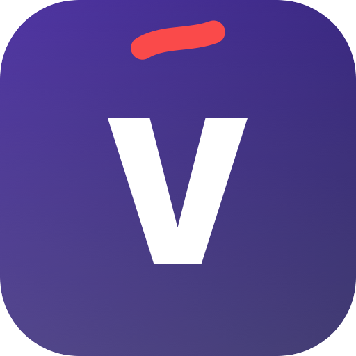
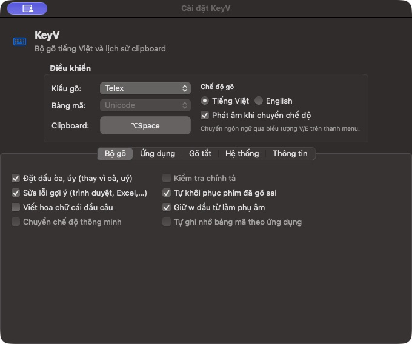
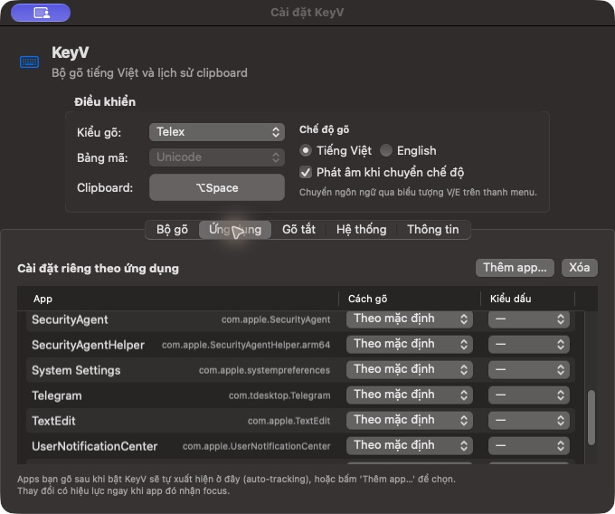
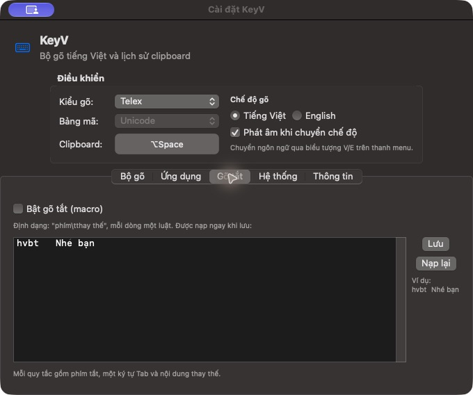
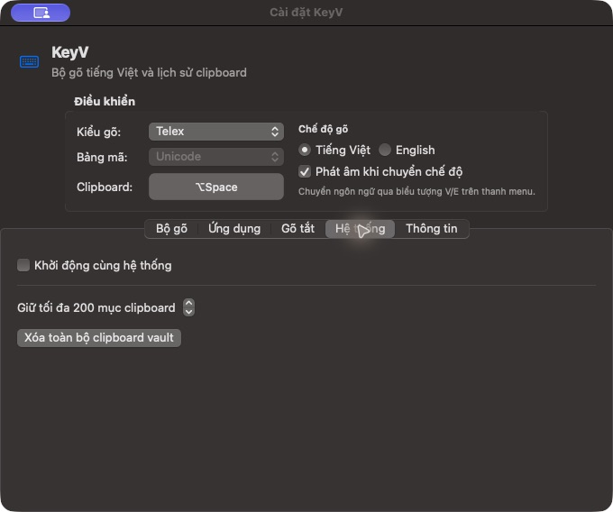
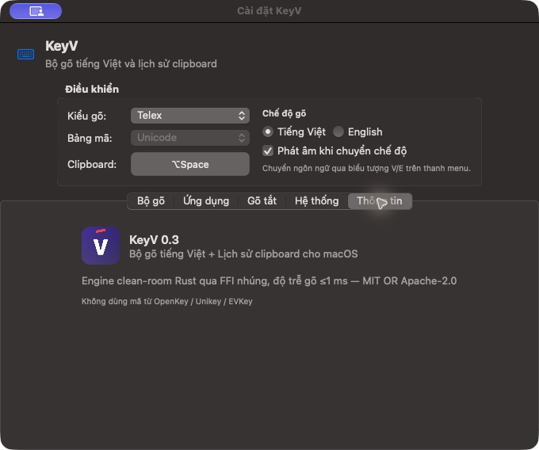

<p align="center"></p>

# KeyV — Bộ gõ tiếng Việt cho macOS

Bộ gõ tiếng Việt trên thanh menu, kết hợp lịch sử clipboard, viết bằng **Rust + SwiftUI/AppKit**. Engine chạy trực tiếp trong ứng dụng qua C ABI, không cần dịch vụ mạng.

> **Đang phát triển.** KeyV hướng đến thói quen gõ UniKey trên Windows nhưng chưa tương thích hoàn toàn. Hiện phát hành mã nguồn; chưa có bản cài đặt được notarize hay bộ kiểm thử gõ thật đầy đủ trên mọi ứng dụng.



## Tính năng

| Chức năng | Hiện trạng |
| --- | --- |
| Kiểu gõ | Telex, Simple Telex, VNI và chế độ English |
| Unicode | Chữ thường, chữ hoa và 5 dấu thanh |
| Đặt dấu | Kiểu cũ / mới cho các vần như òa / oà, úy / uý |
| Phím lặp | Khôi phục dấu và chữ: `ww`, `aaa`, `ddd`, `guitarr`; VNI có khôi phục dấu thanh lặp |
| Cấu hình ứng dụng | Chọn kiểu gõ và kiểu dấu riêng theo bundle ID |
| Gõ tắt | Bảng TSV, nạp lại khi lưu, bật/tắt trong cài đặt |
| Clipboard | Văn bản, ảnh, URL tệp; lịch sử lưu bằng SQLite, payload mã hóa AES-256-GCM |
| Tiện ích | Phím mở clipboard tùy chỉnh, giới hạn lịch sử, khởi động cùng hệ thống |

## Ảnh giao diện

Ảnh chụp cửa sổ ứng dụng đang chạy trên macOS, không phải bản vẽ giao diện. Các sửa engine mới nhất trong mã nguồn không làm thay đổi bố cục này. Không đưa nội dung clipboard cá nhân lên repository.

### Cài đặt riêng cho ứng dụng

Chọn **Theo mặc định** để bỏ cấu hình riêng và dùng thiết lập chung.



### Gõ tắt

Mỗi dòng chứa phím tắt, một ký tự **Tab thật**, rồi nội dung thay thế. Ví dụ `hvbt` → `Nhé bạn`. Lưu bảng và bật gõ tắt để sử dụng.



### Hệ thống và clipboard

Phím mặc định mở lịch sử clipboard là **⌥ Space**. Đây không phải phím chuyển Việt/Anh. Dùng ↑/↓ để chọn, Return để dán và Esc để đóng. Tab Hệ thống cho phép đặt số mục lưu và xóa lịch sử.



<details>
<summary>Thông tin ứng dụng</summary>



Ảnh tab Thông tin còn hiển thị số phiên bản và thông tin hiệu năng từ bản phát triển. Chưa có benchmark độc lập xác nhận độ trễ ≤1 ms; không xem đó là cam kết hiệu năng.

</details>

## Build và chạy

### Yêu cầu

- macOS 14 trở lên.
- Rust hỗ trợ edition 2024 (Rust 1.88+; dùng bản stable mới nhất).
- Swift 5.10+ và toolchain tương thích SDK macOS của máy; cài Xcode hoặc Command Line Tools.
- Bộ công cụ `cargo`, `swift`, `codesign`, `iconutil` có trong PATH.

```bash
git clone https://github.com/nhuuduc/keyv.git
cd keyv
./scripts/build.sh
open apps/keyv-app/KeyV.app
```

Script build Rust static library, build các target Swift, chạy `KeyVSmoke`, đóng gói rồi kiểm tra chữ ký app. Build hiện tại được kiểm tra trên Apple Silicon; chưa xác nhận Intel hoặc universal binary.

### Cấp quyền Trợ năng

KeyV cần quyền Trợ năng để nhận phím và chèn chữ vào ứng dụng đang gõ:

1. Mở KeyV và chọn **Mở Cài đặt…**.
2. Bật KeyV tại **Privacy & Security → Accessibility**, hoặc **Device Control and Data Access** tùy phiên bản macOS.
3. Quay lại KeyV hoặc bấm **Kiểm tra lại**. App chỉ báo sẵn sàng khi tạo được keyboard event tap.

Nếu công tắc đã bật mà app vẫn chưa nhận: bản build mới có thể không khớp chữ ký đã được macOS cấp quyền. Dùng **Hiện app trong Finder**, xóa mục KeyV cũ khỏi danh sách quyền rồi thêm đúng bản hiện tại. Có thể cần thoát và mở lại app.

Build mặc định ký **ad-hoc**: chữ ký định danh có thể thay đổi mỗi lần build. Để giữ danh tính qua các bản build, sử dụng cùng chứng chỉ ký code đã cài trong Keychain:

```bash
KEYV_SIGNING_IDENTITY='Developer ID Application: Your Name (TEAMID)' ./scripts/build.sh
```

Dự án không kèm chứng chỉ, không tự cấp quyền và không tự sửa cơ sở dữ liệu quyền của macOS.

## Gõ tiếng Việt và tiếng Anh

Để gõ `win` thành đúng `win`, bật **Giữ w đầu từ làm phụ âm**. Nếu tắt tùy chọn này, `w` đầu từ là phím viết nhanh `ư`; bật khôi phục phím lặp để dùng `ww` trả về `w`.

| Phím gõ | Kết quả trong engine |
| --- | --- |
| `ddawng` | đăng |
| `tieengs Vieetj` | tiếng Việt |
| `dduwowngf` | đường |
| `toanfs` | toán |
| `aaa`, `eee`, `ooo`, `ddd` | aa, ee, oo, dd khi bật khôi phục |
| `wwin` | win khi tắt giữ w đầu từ và bật khôi phục |
| `e11` (VNI) | e1 khi bật khôi phục |

Quy tắc tham khảo: [hướng dẫn UniKey](https://www.unikey.org/support/ukmanual.html). Các bài kiểm tra được viết theo quy tắc công khai; dự án không nhúng engine UniKey.

Tùy chọn giữ `w` chỉ áp dụng đầu từ, không tự nhận diện mọi từ tiếng Anh. Để nhập tiếng Anh nguyên trạng, chuyển sang **English** qua menu V/E. Tránh chạy đồng thời nhiều bộ gõ tiếng Việt trên cùng luồng phím.

## Kiểm thử

```bash
cargo test --workspace
cargo clippy --workspace --all-targets -- -D warnings
./scripts/build.sh
```

Hiện có **33 bài kiểm tra Rust**, gồm 6 nhóm kiểm tra bổ sung cho các quy tắc gần UniKey, cùng kiểm tra Swift qua FFI và hồi quy cài đặt trong `KeyVSmoke`. Các nhóm bao gồm nhiều chuỗi phím.

Kiểm tra tự động không thay thế thử nghiệm bàn phím vật lý: phím tổng hợp từ công cụ automation có thể bị bỏ qua để tránh vòng lặp; autocorrect của ứng dụng đích cũng có thể thay đổi kết quả.

## Dữ liệu cục bộ

- Lịch sử clipboard: `~/Library/Application Support/KeyV/clipboard.db`.
- Khóa mã hóa lưu trong macOS Keychain; metadata không được tuyên bố là mã hóa toàn bộ.
- Bảng gõ tắt: `~/Library/Application Support/KeyV/macros.tsv`.
- Cài đặt: UserDefaults của `app.keyv.host`.
- Bộ thu clipboard bỏ qua các marker concealed/transient/auto-generated mà ứng dụng nguồn cung cấp. Đây không phải cơ chế nhận diện mọi bí mật trong clipboard.

## Kiến trúc

```text
crates/keyv-core/        Rust engine, Telex/VNI, bảng Unicode, C ABI, tests
apps/keyv-app/
  Sources/KeyVCore/      Swift wrapper của Rust engine
  Sources/KeyVHostKit/   Event tap, chèn chữ, clipboard và giao diện
  Sources/KeyVApp/       Điểm vào ứng dụng thanh menu
  Sources/KeyVIME/       Helper InputMethodKit thử nghiệm
  Sources/KeyVSmoke/     Kiểm tra Swift/FFI
  Sources/KeyVVisual/    Công cụ render thử, chưa render đủ native controls
scripts/                Build, tạo icon, đóng gói app
```

## Giới hạn hiện tại

- Chưa hoàn toàn giống UniKey Windows; Simple Telex còn chia sẻ phần lớn xử lý với Telex.
- Chưa có tự nhận diện tiếng Anh, kiểm tra chính tả đầy đủ hay hỗ trợ bảng mã TCVN3/VNI. Những tùy chọn chưa triển khai bị vô hiệu hóa trên UI.
- Chưa kiểm tra toàn diện với mọi trình duyệt, terminal, Excel, ô mật khẩu và autocomplete.
- InputMethodKit helper là thử nghiệm, không phải đường chạy mặc định.
- Chưa có bản phát hành notarized, trình tự cập nhật hoặc benchmark đáng tin cậy.

Khi báo lỗi, ghi rõ macOS, ứng dụng đích, kiểu gõ, tùy chọn, chuỗi phím đã bấm và kết quả mong đợi/thực tế. Không đính kèm clipboard hay dữ liệu riêng tư.

## Giấy phép

MIT hoặc Apache-2.0, theo lựa chọn của bạn. Xem [LICENSE-MIT](LICENSE-MIT) và [LICENSE-APACHE](LICENSE-APACHE).
