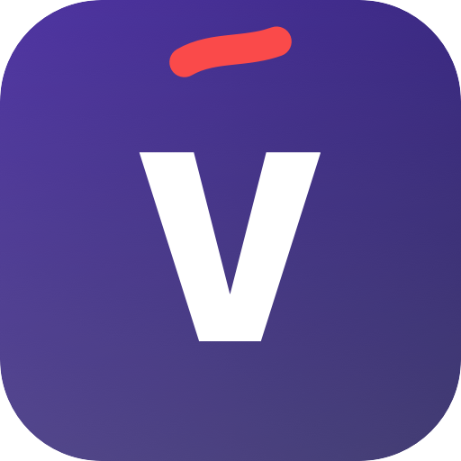
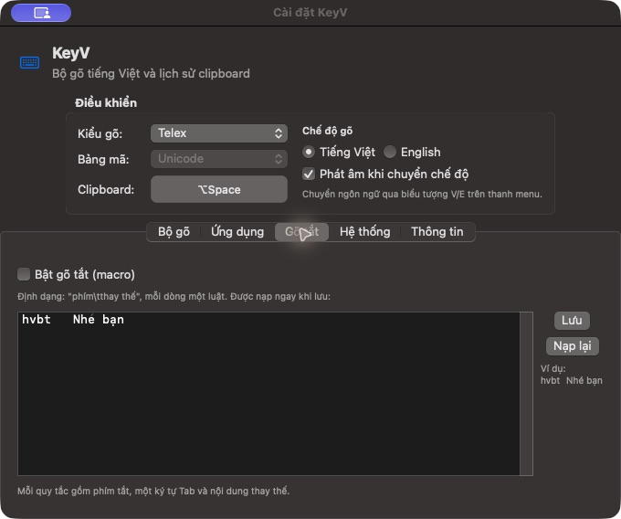
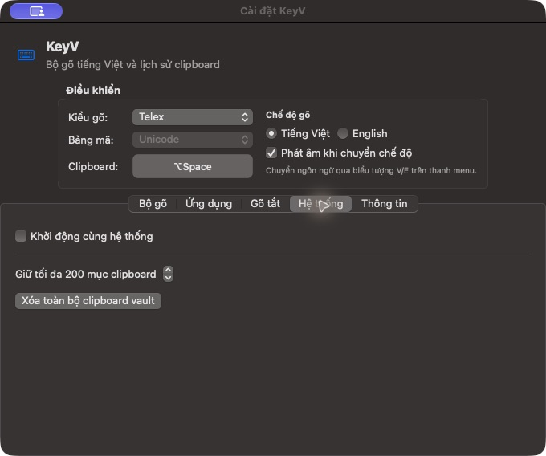

<p align="center"></p>

# KeyV — Bộ gõ tiếng Việt cho macOS

Bộ gõ tiếng Việt trên thanh menu kết hợp lịch sử clipboard mã hóa, viết bằng **Rust + SwiftUI/AppKit**. Engine chạy trực tiếp trong tiến trình ứng dụng qua C ABI (không IPC, không yêu cầu mạng khi gõ).


## Tính năng nổi bật

| Chức năng | Chi tiết |
| --- | --- |
| Kiểu gõ chuẩn UniKey | Telex (bỏ dấu tự do, `ươ` một phím `w`, `gi`/`qu`, nguyên âm ba `oai/oay/uyu/uyê/...`), Simple Telex, VNI (`dang9`, `duong972`,…) và chế độ English |
| Đặt dấu & tái định vị | Hỗ trợ kiểu cũ (`òa, úy`) / kiểu mới (`oà, uý`); tự động dời vị trí dấu thanh khi gõ thêm nguyên âm hoặc phụ âm cuối (`toafn` → `toàn`, `gifa` → `già`, `qura` → `quả`) |
| Kiểm tra chính tả & tiếng Anh | Nhận diện cấu trúc âm tiết tiếng Việt, giữ nguyên từ tiếng Anh (`terminal`, `macos`, `github`, `Swift`, `Windows`,…) và tự khôi phục phím lặp (`aaa`, `ddd`, `aww`, `dduoww`, `barr`) |
| Đồng bộ Backspace & đa ứng dụng | Xóa lùi (`⌫`) giữ nguyên trạng thái âm tiết đang gõ; tương thích trình duyệt (Chrome, Safari, Arc, Brave, Firefox), Electron (VS Code, Notion), Terminal/iTerm2/Ghostty, Spotlight và hộp thoại Open/Save |
| Chuyển nhanh Việt / Anh | Bấm **Ctrl + Shift** (kiểu UniKey Windows), phím tắt tùy chỉnh (**Option + Z** mặc định) hoặc biểu tượng **V / E** trên thanh menu |
| Cấu hình theo ứng dụng | Chọn kiểu gõ và kiểu dấu riêng theo từng `bundleIdentifier` |
| Gõ tắt (Macro) | Bảng TSV nạp trực tiếp khi lưu, hỗ trợ tự động viết hoa khi gõ tắt IN HOA (`DDK` → `ĐĂNG KÝ`) |
| Lịch sử Clipboard | Văn bản, ảnh, tệp; lưu SQLite mã hóa AES-256-GCM với khóa trong macOS Keychain, bỏ qua dữ liệu nhạy cảm (`ConcealedType`) |
| Tự động cập nhật | Kiểm tra bản mới từ **GitHub Releases** (`nhuuduc/keyv`), xác minh SHA-256 & chữ ký số `codesign`, thay thế `.app` an toàn và tự khởi động lại |

## Ảnh giao diện

### Cài đặt riêng cho ứng dụng


### Gõ tắt



### Hệ thống và clipboard



<details>
<summary>Thông tin ứng dụng</summary>


</details>

## Cài đặt & Build từ mã nguồn

### Yêu cầu

- macOS 14 trở lên.
- Rust hỗ trợ edition 2024 (Rust 1.88+ stable).
- Swift 5.10+ (Xcode hoặc Command Line Tools).
- Công cụ hệ thống: `cargo`, `swift`, `codesign`, `openssl`, `ditto`, `hdiutil`.

### Build nhanh (giữ quyền Trợ năng qua các lần build/cập nhật)

```bash
git clone https://github.com/nhuuduc/keyv.git
cd keyv

# 1. Tạo chứng chỉ ký code cục bộ một lần duy nhất (giữ quyền Accessibility không bị mất khi build lại)
./scripts/setup_signing_cert.sh

# 2. Build Rust core + Swift app + chạy bộ test và đóng gói KeyV.app
./scripts/build.sh
open apps/keyv-app/KeyV.app
```

Để đóng gói bản phân phối Universal (`arm64` + `x86_64`) kèm `.zip`, `.dmg` và `SHA256SUMS.txt`:

```bash
KEYV_UNIVERSAL=1 ./scripts/build.sh
./scripts/package_release.sh dist
```

## Ký số (Code Signing) & Giữ quyền Trợ năng (TCC)

macOS quản lý quyền **Privacy & Security → Accessibility** dựa trên *Designated Requirement* của chữ ký số trong `KeyV.app`:

- Nếu ký `ad-hoc` (`codesign --sign -`), macOS gắn quyền vào mã băm `cdhash` của từng file nhị phân — mỗi lần cập nhật hoặc build lại sẽ phải bật lại quyền Trợ năng.
- Khi ký bằng **chứng chỉ cố định** (`Developer ID Application` hoặc chứng chỉ tự ký `KeyV Code Signing` tạo bởi `./scripts/setup_signing_cert.sh`), macOS neo quyền vào định danh `app.keyv.host` + chứng chỉ gốc, giúp **quyền Trợ năng được giữ nguyên xuyên suốt các bản cập nhật**.

### Cấu hình GitHub Secrets cho CI/CD Release (tùy chọn, làm 1 lần)

Workflow [`.github/workflows/release.yml`](.github/workflows/release.yml) tự động build Universal `.app`, `.zip`, `.dmg`, `SHA256SUMS.txt` và phát hành lên **GitHub Releases** khi đẩy tag `v*` (ví dụ `git tag v0.3.0 && git push origin v0.3.0`) hoặc bấm **Run workflow**.

Để mọi bản phát hành từ GitHub Actions giữ nguyên chữ ký số (giúp người dùng cập nhật tự động không mất quyền Accessibility):

1. **Dùng chứng chỉ `KeyV Code Signing` (miễn phí, không cần tài khoản Apple Developer trả phí):**
   Chạy lệnh sau trên máy Mac để xuất giá trị Base64 và mật khẩu:
   ```bash
   ./scripts/setup_signing_cert.sh --export-ci
   ```
   Sau đó thêm 2 Repository Secrets trên GitHub (`Settings → Secrets and variables → Actions`):
   - `KEYV_CERT_P12_BASE64`: chuỗi Base64 của file `.p12`
   - `KEYV_CERT_PASSWORD`: mật khẩu bảo vệ file `.p12`

2. **Hoặc dùng chứng chỉ `Developer ID Application` của Apple (+ Notarization tùy chọn):**
   Xuất chứng chỉ `Developer ID Application` ra `.p12`, đặt vào `KEYV_CERT_P12_BASE64` và `KEYV_CERT_PASSWORD`. Nếu muốn tự động **Apple Notarize + Staple** file `.dmg`/`.app`, thêm tiếp 3 secrets:
   - `APPLE_ID`: email tài khoản Apple Developer
   - `APPLE_TEAM_ID`: mã Team ID 10 ký tự
   - `APPLE_APP_SPECIFIC_PASSWORD`: mật khẩu ứng dụng tạo tại `appleid.apple.com`

*(Nếu chưa cấu hình bất kỳ secret nào, GitHub Actions vẫn build và phát hành bình thường với định danh cố định `app.keyv.host`.)*

## Quy tắc gõ tiếng Việt & tiếng Anh tham khảo

| Chuỗi phím | Kết quả | Ghi chú |
| --- | --- | --- |
| `dduowngf`, `dduongwf`, `duongwfd` | `đường` | Bỏ dấu tự do, `uow` / `uo+w` tự thành `ươ` |
| `nuowcs`, `nguowif`, `ruowuj`, `huowu` | `nước`, `người`, `rượu`, `hươu` | Tự động xử lý vần `ươ` và ba nguyên âm |
| `thuowr` / `thuowng`, `huow` / `huowng` | `thuở` / `thương`, `huơ` / `hương` | Phân biệt chính xác vần mở `uơ` và vần đóng `ươ` |
| `toafn`, `gifa`, `qura`, `khuyur` | `toàn`, `già`, `quả`, `khuỷu` | Tự động định vị lại dấu thanh khi gõ thêm âm cuối |
| `muaw`, `choiw`, `comw`, `nhungwx` | `mưa`, `chơi`, `cơm`, `những` | Bỏ dấu `w` cuối âm tiết kiểu UniKey |
| `duong972`, `dang9`, `to16` (VNI) | `đường`, `đang`, `tố` | Tương thích VNI gõ số cuối từ |
| `terminal`, `macos`, `github`, `Windows` | `terminal`, `macos`, `github`, `Windows` | Tự giữ nguyên từ tiếng Anh khi bật Kiểm tra chính tả |
| `aaa`, `ddd`, `aww`, `dduoww`, `barr` | `aa`, `dd`, `aw`, `đuow`, `bar` | Gõ lặp phím dấu để khôi phục ký tự gốc |

## Kiểm thử

```bash
cargo fmt --all -- --check
cargo clippy --workspace --all-targets -- -D warnings
cargo test --workspace
./scripts/build.sh
```

## Dữ liệu cục bộ

- Lịch sử clipboard: `~/Library/Application Support/KeyV/clipboard.db` (payload mã hóa AES-256-GCM; khóa lưu trong macOS Keychain).
- Bảng gõ tắt: `~/Library/Application Support/KeyV/macros.tsv`.
- Cài đặt: `UserDefaults` (`app.keyv.host`).

## Giấy phép

MIT hoặc Apache-2.0, tùy theo lựa chọn của bạn. Xem [LICENSE-MIT](LICENSE-MIT) và [LICENSE-APACHE](LICENSE-APACHE).
